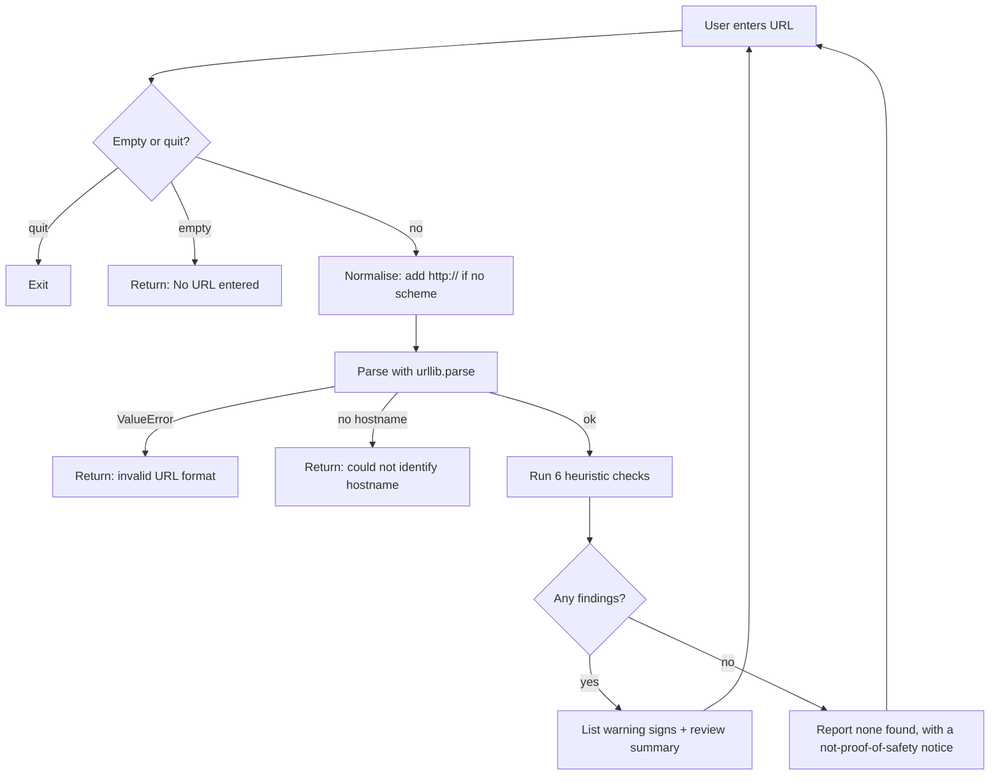

# Phishing URL Awareness Checker

> A lightweight, zero-dependency Python CLI that analyses URL **text** for common phishing indicators, without ever visiting the link.


---

## Table of Contents

- [Overview](#overview)
- [Key Features](#key-features)
- [Tech Stack](#tech-stack)
- [How It Works](#how-it-works)
- [Detection Rules](#detection-rules)
- [Installation & Setup](#installation--setup)
- [Usage](#usage)
- [Folder Structure](#folder-structure)
- [Testing](#testing)
- [Challenges & Solutions](#challenges--solutions)
- [Skills Demonstrated](#skills-demonstrated)
- [Screenshots & Demo](#screenshots--demo)
- [Limitations](#limitations)
- [Future Improvements](#future-improvements)
- [Impact Summary](#impact-summary)
- [Ethical Use](#ethical-use)
- [Contributing](#contributing)
- [License](#license)
- [Author](#author)

---

## Overview

Phishing remains one of the most common entry points for account compromise. Many malicious links share visible structural traits: embedded `@` symbols, raw IP addresses, deeply nested subdomains, punycode hostnames, and unencrypted HTTP.

This project is a **defensive, security-awareness tool** that inspects a URL as plain text and reports which of these indicators are present. It is built to teach users *what to look for* before they click.

**Safety by design:** the program makes **no network requests**. It never opens, resolves, or fetches the URL it analyses.

Built as part of the **EWB Courses Cybersecurity Mini Project**.

## Key Features

- **Six heuristic checks** covering widely documented phishing URL traits
- **Offline and safe:** pure string and URL parsing; no links are visited
- **Interactive loop:** check multiple URLs per session; exit with `q`, `quit`, or `exit`
- **Robust input handling:** empty input, missing hostnames, and malformed URLs return clear messages instead of crashing
- **Accepts URLs with or without a scheme** (`example.com` and `https://example.com` both work)
- **Honest, cautious output:** a clean result is never presented as proof of safety
- **Zero dependencies:** runs anywhere Python runs

## Tech Stack

| Area | Technology |
|---|---|
| Language | Python 3.8+ |
| URL parsing | `urllib.parse` (standard library) |
| Pattern matching | `re` (standard library) |
| Interface | Command-line (CLI) |
| Documentation | Markdown, Mermaid |
| Version control | Git / GitHub |

**Keywords:** Python, cybersecurity, phishing detection, URL analysis, threat indicators, input validation, defensive programming, security awareness, heuristics, regular expressions

## How It Works



The logic lives in two small, separate functions: `inspect_url()` returns a list of findings, and `has_warnings()` distinguishes real warnings from informational messages. This keeps analysis separate from presentation, so the core logic is easy to test and reuse.

## Detection Rules

| # | Indicator | Rule | Why it matters |
|---|---|---|---|
| 1 | `@` symbol | `@` present in the URL | Text before `@` can disguise the real destination host |
| 2 | Long URL | Length over 100 characters | Used to hide the real domain or bury suspicious parameters |
| 3 | IP-based host | Hostname matches an IPv4 pattern | Legitimate services rarely use raw IPs for user-facing links |
| 4 | Excess subdomains | 5 or more hostname labels | Can imitate trusted brands (`login.bank.example.attacker.invalid`) |
| 5 | Punycode | Hostname contains `xn--` | Associated with look-alike (homograph) domains |
| 6 | Plain HTTP | Scheme is `http` | Traffic is unencrypted; HTTPS alone still does not prove trust |

## Installation & Setup

**Requirements:** Python 3.8 or later. No packages to install.

```bash
# 1. Clone the repository
git clone https://github.com/<your-username>/phishing-url-awareness.git
cd phishing-url-awareness

# 2. Run the checker
python3 phishing_checker.py      # macOS / Linux
python phishing_checker.py       # Windows (or: py phishing_checker.py)
```

## Usage

Start the program, enter a URL, and review the findings. Type `q` to quit.

**Example session**

```text
EWB Phishing URL Awareness Checker
Text checks only - this program does not open URLs.

Enter a sample URL (or type q to quit): http://192.0.2.10/account

Result:
- Uses an IP address instead of a familiar domain.
- Uses HTTP. HTTPS alone does not prove trust.

REVIEW CAREFULLY: 2 warning sign(s) found.
Never enter passwords from unexpected links.
```

**More examples**

| Input | Findings |
|---|---|
| `https://www.example.com/login` | No listed warning signs found (this does **not** prove safety) |
| `http://example.com@sample.invalid/login` | `@` symbol; HTTP |
| `https://a.b.c.d.e.example.invalid/path` | Many hostname segments |
| `https://xn--example.invalid/` | Punycode-style hostname |
| `http://[bad` | Not a valid URL format (handled gracefully) |

**Use as a module**

```python
from phishing_checker import inspect_url, has_warnings

findings = inspect_url("http://192.0.2.10/account")
print(findings)
print(has_warnings(findings))  # True
```

## Folder Structure

```text
phishing-url-awareness/
├── phishing_checker.py      # Core logic and CLI loop
├── requirements.txt         # Intentionally empty: standard library only
├── README.md
├── tests/
│   └── test_samples.md      # Manual test matrix (inputs, expected, actual)
└── screenshots/
    ├── sample_run.png       # Terminal demo (add your own)
    └── test_results.png     # Test evidence (add your own)
```

## Testing

Testing is currently **manual and documented**. [`tests/test_samples.md`](tests/test_samples.md) contains a matrix of:

- 5 sample URLs, each targeting a specific indicator (or the clean case)
- 2 behaviour checks: malformed input (`http://[bad`) and clean exit with `q`

Each case lists the expected result, the actual result, and PASS/FAIL. Only reserved or example domains (`example.com`, `192.0.2.x`, `.invalid`) are used, so no real sites are involved.

Automated tests with `pytest` are planned (see [Future Improvements](#future-improvements)).

## Challenges & Solutions

| Challenge | Solution |
|---|---|
| **Malformed URLs crashed parsing.** Input like `http://[bad` makes `urlparse` raise `ValueError`. | Wrapped parsing in `try/except ValueError` and return a clear message so the session continues. |
| **Users often paste URLs without a scheme.** `urlparse("example.com")` yields no hostname. | Prepend `http://` before parsing when `://` is missing, so the hostname is still extracted. |
| **Telling warnings apart from info messages.** The summary should only appear for real findings, not for "empty input" or "invalid format". | Centralised informational messages in a tuple and added `has_warnings()` to classify results. |
| **Avoiding false reassurance.** A "clean" result could mislead users into trusting a link. | Wording explicitly states that no findings does **not** prove safety, and that HTTPS alone is not trust. |
| **Keeping the tool safe to run.** Security tools that fetch URLs can themselves be risky. | Restricted the design to offline text analysis; no sockets, DNS, or HTTP calls. |

## Skills Demonstrated

- **Security thinking:** translating phishing tradecraft into concrete, checkable indicators
- **Python fundamentals:** functions, control flow, exceptions, standard library (`re`, `urllib.parse`)
- **Input validation & error handling:** defensive handling of empty, malformed, and unexpected input
- **Secure-by-design principles:** no network access, no data collection, explicit limitations
- **Clean code structure:** separation between analysis (`inspect_url`), classification (`has_warnings`), and I/O (`main`)
- **QA mindset:** documented test matrix with expected vs. actual results
- **Technical writing:** clear documentation, honest scoping, and ethical-use guidance
- **Git/GitHub workflow:** structured repository ready for collaboration

## Screenshots & Demo

> Replace these placeholders with your own real screenshots.

| Sample run | Test results |
|---|---|
|  |  |

<!-- Optional: add a short terminal recording (asciinema or GIF) here -->

## Limitations

- Checks six visible text patterns only; **it is not a complete phishing detector**
- Does not check domain reputation, WHOIS age, certificates, page content, or redirects
- IPv4 only (IPv6 hosts are not flagged)
- Scheme-less input is treated as `http://` for parsing, so it also triggers the HTTP notice
- Fixed thresholds (100 characters, 5 labels) are heuristics and can produce false positives and false negatives

## Future Improvements

- [ ] Add automated unit tests with `pytest` and a GitHub Actions CI workflow
- [ ] Add a risk score (Low / Medium / High) with weighted indicators
- [ ] Detect look-alike brand domains (typosquatting via edit distance)
- [ ] Flag suspicious keywords (`login`, `verify`, `secure`) and known URL shorteners
- [ ] Support IPv6 and URL-encoded obfuscation
- [ ] Add batch mode: read URLs from a file and export results to CSV/JSON
- [ ] Add `argparse` flags for non-interactive use (`python phishing_checker.py --url ...`)
- [ ] Optional integration with a threat-intelligence API (opt-in, clearly separated from offline mode)
- [ ] Package as an installable CLI and add type hints

## Impact Summary

- Designed and built a **Python CLI** implementing **6 phishing URL heuristics** using only the standard library
- Engineered **fault-tolerant input handling** for empty, malformed, and scheme-less URLs
- Applied **secure-by-design** principles: fully offline analysis with no network calls
- Authored a **documented test matrix** (7 cases) and project documentation with explicit limitations and ethical-use guidance
- Structured the codebase to separate **detection logic, classification, and I/O** for easy testing and extension

## Ethical Use

This is an **educational, defensive** tool.

- Test only with reserved or example strings (`example.com`, `192.0.2.x`, `.invalid`)
- Do not use it to collect credentials or craft phishing messages
- Do not scan or probe websites or networks without written authorisation
- Never commit passwords, API keys, tokens, or private data

## Contributing

Contributions, issues, and suggestions are welcome.

1. Fork the repository
2. Create a feature branch: `git checkout -b feature/your-feature`
3. Keep changes focused, and follow PEP 8 with clear docstrings
4. Add or update test cases in `tests/` for any new indicator
5. Commit with a clear message: `git commit -m "Add: short description"`
6. Push and open a Pull Request describing what changed and why

Please keep the tool **offline and non-intrusive** by default.

## License

Distributed under the **MIT License**. Add a `LICENSE` file to the repository root (GitHub can generate one via *Add file → Create new file → `LICENSE`*).

## Author

**[Amresh Choudhary]**
 EWB Courses : AI with Cybersecurity
[LinkedIn](https://linkedin.com/in/amresh-choudhary-a17443360

) · [GitHub](https://github.com/amreshchoudhary22-glitch) · E mail id : amreshchoudhary22@gmail.com

